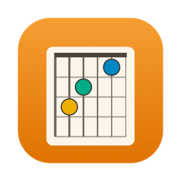
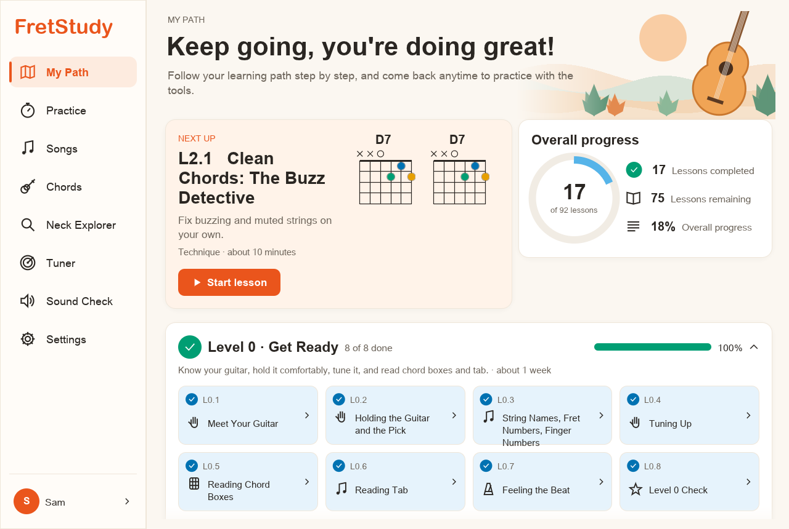
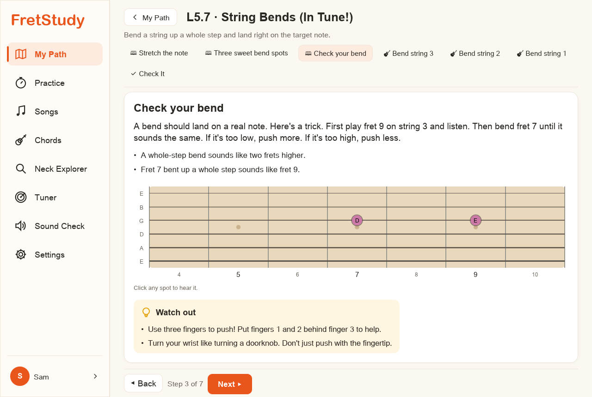
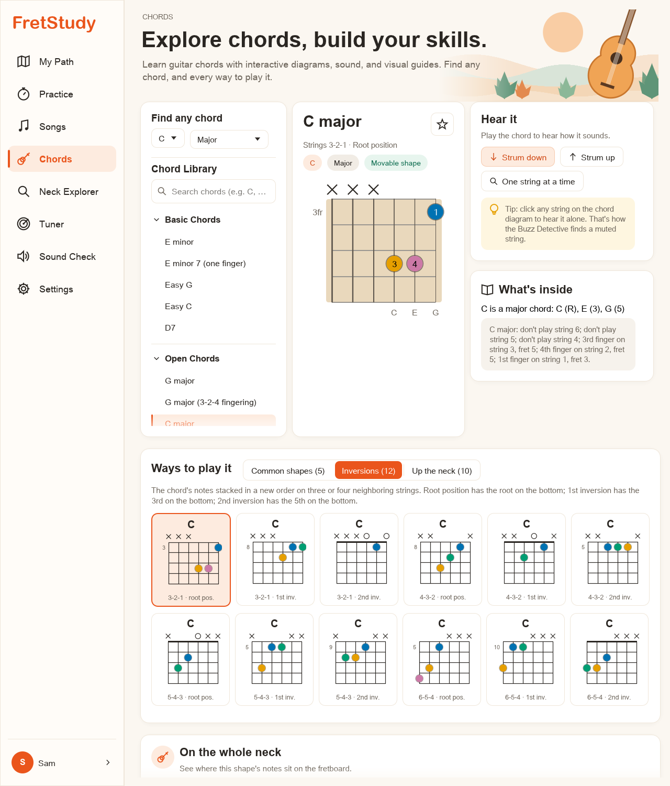
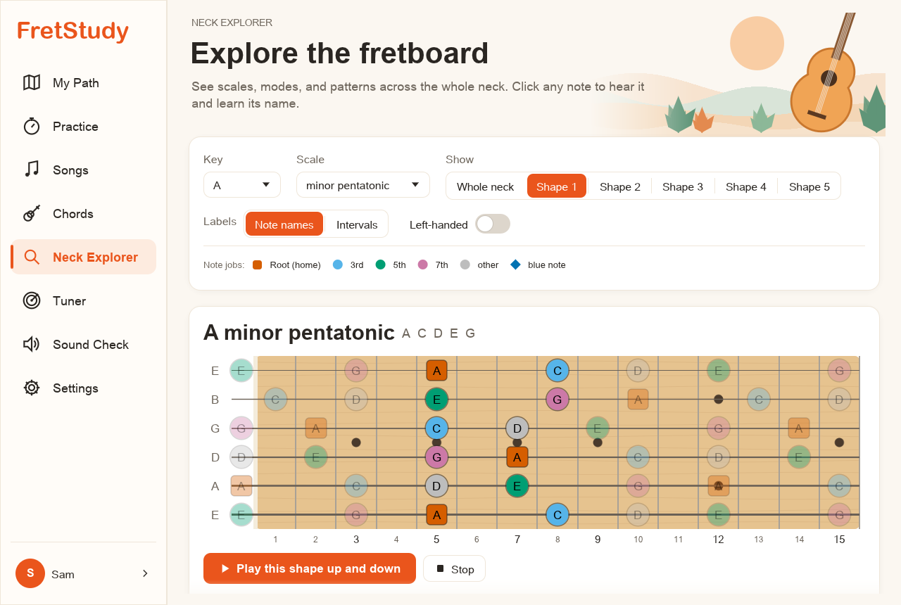

<p align="center">
  
</p>

<h1 align="center">FretStudy</h1>

<p align="center">
  <b>Learn guitar step by step, from your very first chord to writing your own songs.</b><br>
  A free desktop app for Mac, Windows, and Linux, for kids and adults.
</p>

<p align="center">
  <a href="https://github.com/elevatedesigns/FretStudy/releases/latest/download/FretStudy-macOS.dmg"><b>⬇ Mac</b></a> ·
  <a href="https://github.com/elevatedesigns/FretStudy/releases/latest/download/FretStudy-Windows-Setup.exe"><b>⬇ Windows</b></a> ·
  <a href="https://github.com/elevatedesigns/FretStudy/releases/latest/download/FretStudy-Linux-x86_64.AppImage"><b>⬇ Linux</b></a>
</p>



## Download

| Computer | Download | Notes |
|---|---|---|
| **Mac** (Apple Silicon and Intel, macOS 11+) | [**FretStudy-macOS.dmg**](https://github.com/elevatedesigns/FretStudy/releases/latest/download/FretStudy-macOS.dmg) | Open it and drag FretStudy into Applications. |
| **Windows** 10 / 11 | [**FretStudy-Windows-Setup.exe**](https://github.com/elevatedesigns/FretStudy/releases/latest/download/FretStudy-Windows-Setup.exe) | Installer. No admin password needed. |
| **Windows** (no install) | [**FretStudy-Windows-Portable.zip**](https://github.com/elevatedesigns/FretStudy/releases/latest/download/FretStudy-Windows-Portable.zip) | Unzip, then run `FretStudy.exe`. |
| **Linux** (x86_64) | [**FretStudy-Linux-x86_64.AppImage**](https://github.com/elevatedesigns/FretStudy/releases/latest/download/FretStudy-Linux-x86_64.AppImage) | One file: make it executable, then run it. |
| **Linux** (plain binary) | [**FretStudy-Linux-x86_64.tar.gz**](https://github.com/elevatedesigns/FretStudy/releases/latest/download/FretStudy-Linux-x86_64.tar.gz) | Binary, `.desktop` file, and icon. |

All versions are on the [Releases page](https://github.com/elevatedesigns/FretStudy/releases).

### First launch

The apps aren't code-signed yet, so your computer may warn you the first time you open FretStudy. This is a one-time step.

- **Mac:** if macOS says FretStudy "can't be opened," open **System Settings → Privacy & Security**, scroll down, and click **Open Anyway**. Or run `xattr -dr com.apple.quarantine /Applications/FretStudy.app` in Terminal.
- **Windows:** if SmartScreen says "Windows protected your PC," click **More info → Run anyway**.
- **Linux:** run `chmod +x FretStudy-Linux-x86_64.AppImage`, then double-click it or run `./FretStudy-Linux-x86_64.AppImage`.

FretStudy asks to use your microphone so it can check your tuning, chords, and timing. Everything stays on your computer.

## What's inside

- **A full learning path:** 92 lessons in 8 levels, from "Meet Your Guitar" to 7th chords, modes, and writing your own song. A placement quiz lets experienced players skip what they already know.
- **7 style tracks:** Blues, Rock, Fingerstyle & Folk, Jazz, Classical, Alternate Tunings & Songwriting, and Tone & Gear (56 more lessons).
- **Lessons made for real learning:** short explanations written at about a 5th-grade reading level, plenty of pictures (chord boxes, neck maps, tab, rhythm grids, notation), "Watch out" tips for common mistakes, a weekly practice plan, and a quiz that explains *why* when you pick a wrong answer.
- **It listens to you:** a built-in tuner, plus microphone checks for chords, single notes, and strumming in time.
- **Generated guitar sound:** every chord, scale, and riff can be played aloud, at slow or full speed.
- **Chord explorer:** look up any chord in any key, see its notes and finger roles, and browse every inversion and movable shape up the neck.
- **Neck Explorer:** scales, pentatonic boxes, and modes across the whole fretboard, with left-handed mode.
- **Practice tools:** a daily practice session, metronome, ear-training gym, spaced review, and a song builder.
- **Profiles and backups:** several players can share one computer. Progress is saved locally, and nothing is sent online.
- **Public-domain songs only**, so everything can be shared freely.

| Lessons | Chords | Neck Explorer |
|---|---|---|
|  |  |  |

## Build from source

FretStudy is written in [Rust](https://rustup.rs) with [egui](https://github.com/emilk/egui).

```sh
cargo run --release -p fretstudy
```

On Linux, install the audio and windowing libraries first (Ubuntu/Debian):

```sh
sudo apt install pkg-config libasound2-dev libxkbcommon-dev libwayland-dev \
  libx11-dev libxcursor-dev libxrandr-dev libxi-dev libgl1-mesa-dev
```

### Packaging

| Platform | Command | Output |
|---|---|---|
| Mac | `scripts/package-macos.sh` | `dist/FretStudy-<version>.dmg` (universal app) |
| Windows | `scripts\package-windows.ps1` (needs [Inno Setup 6](https://jrsoftware.org/isinfo.php)) | `dist\FretStudy-<version>-setup.exe` |
| Linux | `scripts/package-linux.sh` | `dist/FretStudy-Linux-x86_64.AppImage` and `.tar.gz` |

To publish a release, push a version tag. GitHub Actions ([`.github/workflows/release.yml`](.github/workflows/release.yml)) builds all three platforms and attaches the downloads to a GitHub Release:

```sh
git tag v0.1.1 && git push origin v0.1.1
```

### Tests

```sh
cargo test --workspace                       # theory, audio DSP, content validator, screen snapshots
UPDATE_SNAPSHOTS=1 cargo test -p fretstudy   # after an intended visual change
```

The content validator checks every lesson automatically:
- Chord shapes must spell their names.
- Answers must be correct, and every quiz answer must come with an explanation.
- Lessons must only use chords that have already been taught.
- Text must stay at about a 5th-grade reading level.
- Every lesson must have enough teaching steps, pictures, tips, and a practice plan.

## Project layout

| Path | What it does |
|---|---|
| `crates/theory` | Music theory: notes, intervals, scales, chords, keys, the fretboard, the chord library, CAGED/barre/pentatonic shapes, and the chord-voicing finder. |
| `crates/audio` | Generated guitar sound (Karplus–Strong strings, body resonance, room reverb), audio output, microphone input, pitch and onset detection, and the tuner. |
| `crates/content` | Lesson data model and loader, learning-path logic, placement quiz, and the content validator. |
| `crates/store` | Local SQLite storage: profiles, settings, progress, and the practice log. |
| `crates/app` | The desktop app (egui): every screen, the lesson player, and the widgets. |
| `content/` | The lessons themselves, as RON files (Levels 0–7 plus `tracks/`). |
| `docs/` | Teaching plan, full curriculum, placement design, and technical architecture. |

Saved data lives in your system's app-data folder. On a Mac, that's `~/Library/Application Support/com.FretStudy.FretStudy/`.
